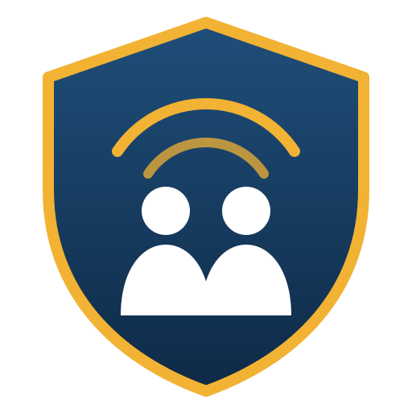
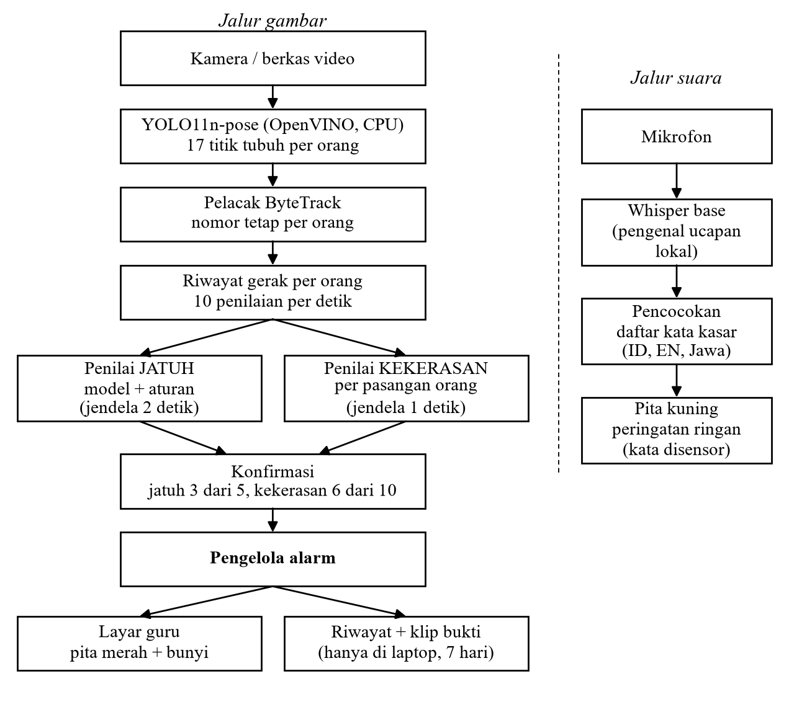
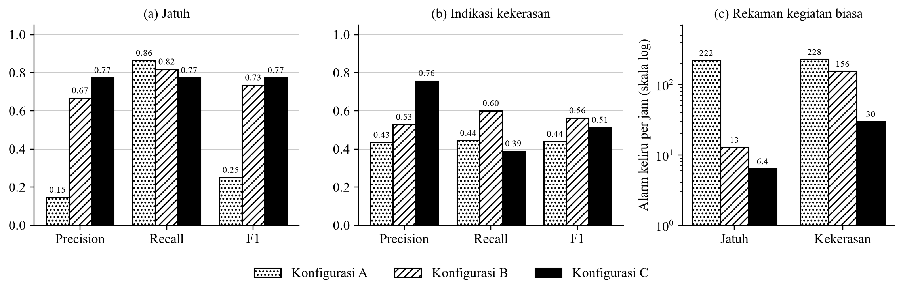
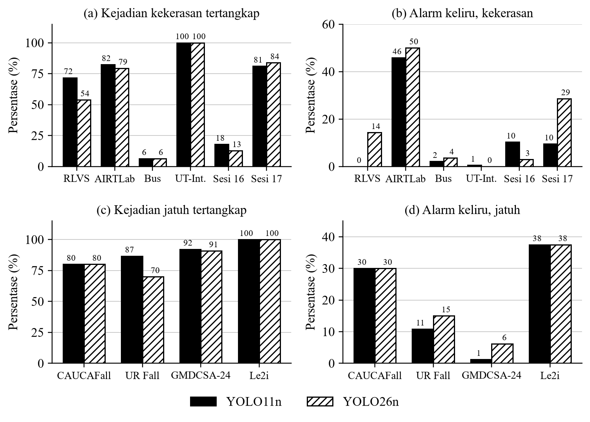

<p align="center">
  
</p>

<h1 align="center">SAHABAT Sekolah</h1>

<p align="center">
  Pendeteksi orang jatuh dan indikasi kekerasan fisik berbasis pose tubuh,<br>
  berjalan sepenuhnya di laptop sekolah tanpa kartu grafis dan tanpa internet.
</p>

<p align="center">
  
  
  
  
  
  
</p>

---

SAHABAT Sekolah menonton satu kamera, mengenali gerakan **jatuh** dan gerakan yang menyerupai **kekerasan fisik**
(memukul, menendang, mendorong, mencekik), lalu membunyikan alarm agar guru segera memeriksa. Sistem juga dapat
memberi peringatan ringan bila terdengar **kata kasar** dalam bahasa Indonesia, Inggris, atau Jawa.

Keputusan tetap berada di tangan guru. Sistem tidak mengenali wajah, tidak menentukan pelaku, dan tidak merekam
video terus-menerus; yang disimpan hanya klip pendek di sekitar setiap kejadian, di laptop itu sendiri.

Proyek ini dikembangkan untuk Indonesian Science Project Olympiad (ISPO) 2027, bidang Komputer,
oleh tim SMP Negeri 29 Semarang.

## Daftar isi

- [Menjalankan](#menjalankan)
- [Cara pakai](#cara-pakai)
- [Cara kerja](#cara-kerja)
- [Hasil pengujian](#hasil-pengujian)
- [Kebutuhan perangkat](#kebutuhan-perangkat)
- [Struktur folder](#struktur-folder)
- [Untuk pengembang](#untuk-pengembang)
- [Privasi](#privasi)
- [Batasan](#batasan)
- [Sumber data](#sumber-data)
- [Lisensi](#lisensi)

## Menjalankan

```bash
git clone https://github.com/naufaldenta/ISPO-PROYEK.git
```

Lalu buka folder `ISPO-PROYEK` dan klik dua kali **`Mulai SAHABAT.bat`**. Tidak perlu memasang Python atau
mengatur apa pun.

- **Penyalaan pertama** mengunduh Python dan pustaka sekitar 1 GB ke folder `runtime/`, ditambah model pengenal
  ucapan sekitar 150 MB. Butuh internet dan memakan waktu 10–30 menit, tergantung kecepatan koneksi. Jangan tutup
  jendela hitamnya sampai selesai.
- **Penyalaan berikutnya** langsung jalan dalam beberapa detik dan **tidak butuh internet**.
- Saat pertama menyala di sebuah laptop, SAHABAT mengukur kecepatan laptop beberapa detik, lalu memilih resolusi
  terbaik yang masih mencapai 10 penilaian per detik. Hasilnya disimpan, jadi pengukuran tidak diulang.

Tanpa Git, unduh lewat tombol **Code → Download ZIP**, ekstrak, lalu klik dua kali `Mulai SAHABAT.bat`.

> Bila persiapan pertama terputus, cukup jalankan `Mulai SAHABAT.bat` lagi. Bagian yang sudah selesai dilewati.

## Cara pakai

1. Setelah `Mulai SAHABAT.bat` dijalankan, browser terbuka sendiri dalam mode layar penuh.
2. Klik **Mulai**. Browser hanya mengizinkan bunyi alarm setelah ada satu klik.
3. Arahkan kamera agar **seluruh badan** orang terlihat, idealnya dari jarak **3–4 meter**.
4. Di tempat ramai (misalnya stan pameran), tekan **Zona** lalu klik sudut-sudut area peragaan. Pengunjung yang
   lewat di luar zona tidak akan memicu alarm. Tandai batas zona di lantai dengan lakban.

| Tampilan / tombol | Fungsi |
|---|---|
| Pita hijau **AMAN** | Tidak ada kejadian |
| Pita merah **JATUH TERDETEKSI** / **INDIKASI KEKERASAN TERDETEKSI** | Alarm menyala disertai bunyi |
| Pita abu-abu | Kamera terputus atau tidak ada orang yang bisa dinilai |
| Pita kuning | Peringatan kata kasar; hilang sendiri, kata disensor |
| **Sudah diperiksa** atau tombol **Spasi** | Mematikan alarm setelah guru memeriksa |
| **Senyap** | Mematikan bunyi alarm |
| **Perangkat** | Memilih kamera, mikrofon, video cadangan, dan volume alarm (ada tombol **Coba bunyi**) |
| **Kamera** | Menambah kamera CCTV (IP camera, channel DVR/NVR, HP, webcam, capture card, video simulasi) dan menyalakan **Mode CCTV** |
| **Riwayat** | Daftar kejadian dan pemutar inspeksi klip bukti; angka merah = kejadian baru yang belum dilihat |
| **Zona** | Menggambar area yang dipantau; orang yang titik tengah badannya di luar zona tidak dinilai |
| **HP / laptop lain** | Membuka layar ini dari HP atau laptop lain di WiFi yang sama (kode QR + kode akses) |
| **Kata kasar** atau tombol **M** | Menghidupkan / mematikan peringatan kata kasar |
| **Balik kiri-kanan** atau tombol **C** | Membalik gambar kamera |

**Buka di HP atau laptop lain.** Tekan **HP / laptop lain**, lalu nyalakan **Jaringan lokal**. Pindai kode QR dengan
kamera HP (atau buka alamat yang tertulis dan ketik kode aksesnya). HP harus tersambung ke WiFi yang sama dengan
laptop SAHABAT. Dari HP, guru bisa melihat layar, mendengar alarm, menekan **Sudah diperiksa**, dan membuka
**Riwayat**; pengaturan tetap hanya dari laptop SAHABAT. **Ganti kode akses** langsung memutus semua layar lain.

Bila HP hanya memuat terus:
1. Bila panel menampilkan kotak merah **Windows Firewall masih menutup akses dari HP**, tekan **Izinkan akses dari
   HP** lalu pilih **Ya** di jendela izin Windows. Cukup sekali per laptop. Aturan ini hanya membuka program SAHABAT
   untuk perangkat di jaringan lokal yang sama.
2. Pastikan HP memakai WiFi yang sama, bukan data seluler.
3. WiFi umum (kos, kafe, WiFi tamu sekolah) sering memblokir sesama perangkat. Nyalakan hotspot di HP guru,
   sambungkan laptop SAHABAT ke hotspot itu, lalu pindai kode QR yang baru.

**Menyambungkan CCTV atau IP camera.** Laptop SAHABAT harus tersambung ke jaringan yang sama dengan kamera atau
DVR/NVR, lewat kabel LAN atau WiFi. Tekan **Kamera**, lalu pilih salah satu cara:

- **Cari otomatis**: mencari kamera yang mendukung ONVIF di jaringan. Pilih kameranya, isi nama pengguna dan kata
  sandi, lalu tekan **Ambil alamat stream**. Banyak kamera dan DVR murah tidak mendukung pencarian ini.
- **Pilih merek**: isi IP, channel, nama pengguna, dan kata sandi. Merek yang tersedia: Hikvision/HiLook, Dahua,
  Uniview, TP-Link Tapo/VIGI, EZVIZ, Imou, DVR/NVR murah (XMeye/iCSee), dan HP Android dengan aplikasi
  **IP Webcam** (`http://<ip-hp>:8080/video`). Pilih **Substream** supaya laptop tidak berat.
- **Alamat lengkap**: tempel alamat `rtsp://…` atau `http://…` dari teknisi atau dari aplikasi kamera.
- **Capture card DVR**: untuk DVR tanpa jaringan, sambungkan keluaran HDMI DVR ke capture card USB.

Bila gambar berisi tampilan beberapa kamera sekaligus (mosaik DVR), pilih ukuran grid dan nomor ubinnya. Gambar
satu ubin berukuran kecil, jadi deteksinya kurang akurat dibanding channel kamera langsung.

Tekan **Tes sambungan** untuk melihat cuplikan, ukuran gambar, dan laju kamera, atau alasan gagalnya (misalnya kata
sandi salah, alamat tidak ditemukan, atau kamera tidak menjawab). Lalu tekan **Simpan** dan **Pakai**. Kamera
tersimpan juga muncul di daftar Kamera pada panel **Perangkat**. Kata sandi disimpan terenkripsi di laptop itu
(Windows DPAPI) dan tidak pernah ditampilkan; di laptop atau akun Windows lain, kata sandinya perlu diisi ulang.

Pola alamat tiap merek diambil dari dokumentasi pabrikan dan baru diuji dengan kamera tiruan. Bila satu merek
gagal, coba channel lain, matikan Substream, atau pakai **Alamat lengkap** dari aplikasi kamera.

**Mode CCTV: banyak kamera sekaligus.** Di panel **Kamera**, tandai kamera yang ikut dengan **Aktif di Mode CCTV**,
lalu tekan **Mode CCTV: hidup**. Layar berubah menjadi grid berisi semua kamera aktif. Ketuk satu kamera untuk
memperbesarnya; zona pantau digambar pada kamera yang sedang diperbesar. Untuk simulasi tanpa CCTV, kamera bisa
berupa webcam, HP, atau **Video (simulasi)** dari folder `video/`.

| Status di ubin | Arti |
|---|---|
| **dinilai penuh** | Ada orang: kamera dinilai 10 kali per detik, sama dengan Mode Pameran |
| **siaga** | Tidak ada orang: hanya gerakan yang dicek. Begitu ada gerak, kamera dinilai dalam ≤ 0,5 detik |
| **lambat** | Ada orang, tetapi komputer tidak sanggup menilai 10 kali per detik. Alarm tetap berbunyi, ditandai "(dinilai lambat)" |
| **terputus** | Kamera tidak mengirim gambar; SAHABAT mencoba menyambung lagi sendiri |

Pita alarm menyebut kamera dan jamnya, misalnya `JATUH TERDETEKSI — Kelas 7B — 10.42.13`. Bila beberapa kamera
beralarm, yang paling lama tampil lebih dulu; **Sudah diperiksa** memeriksa kamera itu, **Periksa semua** memeriksa
semuanya. Riwayat mencatat kamera tiap kejadian dan bisa disaring per kamera. Tandai **Prioritas** untuk kamera di
tempat rawan (misalnya tangga): kamera itu didahulukan bila komputer kewalahan.

Setiap kamera dinilai dengan model dan pelacak yang sama persis dengan Mode Pameran, jadi akurasi per kamera tidak
berubah selama kamera itu dinilai penuh. Yang membatasi adalah tenaga komputer. Saat Mode CCTV dinyalakan, SAHABAT
mengukur komputernya dan menuliskan, misalnya, "Komputer ini sanggup menilai 1 kamera penuh sekaligus". Laptop tanpa
kartu grafis biasanya hanya sanggup menilai **satu** kamera penuh sekaligus. Beberapa kamera tetap bisa dipantau karena
kamera kosong hampir tidak memakai tenaga, tetapi bila dua kamera ramai bersamaan, keduanya menjadi **lambat**. Untuk
pemasangan sungguhan dengan lebih dari 2 kamera, pakai komputer dengan kartu grafis.

Layar HP / laptop lain (jaringan lokal) menampilkan grid yang sama dengan gambar kecil 5 fps supaya WiFi tidak berat.
Menyalakan Mode CCTV, mengubah kamera, dan menggambar zona tetap hanya dari laptop SAHABAT. Mode CCTV yang dinyalakan
diingat dan menyala lagi saat SAHABAT dimulai ulang.

**Melihat ulang kejadian (inspeksi).** Tekan **Riwayat**, lalu pilih kejadian. Klip bukti diputar di pemutar inspeksi:

- **Gerak lambat** 0,25×, 0,5×, 1×; **jeda** dan **maju/mundur satu frame** (tombol atau ← / →, spasi = putar/jeda).
- **Garis waktu**: penanda merah = detik kejadian, penanda jingga = saat penilai di atas ambang. Klik untuk melompat.
- **Perbesar**: gulir atau cubit; seret untuk menggeser; **Ukuran asli** untuk kembali.
- **Kerangka** bisa disembunyikan untuk melihat gambar asli, dan **Sorot orang terlibat** meredupkan orang lain.
- **Kamera lain pada saat itu** (Mode CCTV): membuka klip kamera lain pada detik yang sama.
- **Simpan gambar** (PNG) dan **Unduh MP4**, lengkap dengan nama kamera dan jam, untuk laporan ke wali kelas atau
  kepala sekolah.
- **Tindak lanjut**: tandai **Kejadian benar**, **Alarm keliru**, atau **Perlu tindak lanjut**, dan tulis catatan
  singkat. Ringkasannya tampil di bawah daftar kejadian dan berguna untuk menghitung alarm keliru di pemakaian nyata.

SAHABAT membantu melihat ulang; keputusan tetap di tangan guru. Dari HP / laptop lain, klip bisa diputar, diperlambat,
dan diperbesar, tetapi simpan gambar, unduh MP4, dan tanda tindak lanjut hanya dari laptop SAHABAT. Klip lama (sebelum
fitur ini) tetap bisa diputar; kerangkanya sudah tergambar sehingga tidak bisa disembunyikan.

**Video cadangan.** Bila kamera bermasalah saat demo, buka **Perangkat**, tekan **Tambah video…** (atau salin video
ke folder `video/` lalu **Cari ulang**), pilih videonya di daftar Kamera, lalu **Terapkan**. Video diputar berulang
dan dinilai seperti kamera. Pilihan ini hanya untuk sesi itu; saat dinyalakan ulang, SAHABAT kembali ke kamera.

`Mulai SAHABAT (rekam uji).bat` menyalakan mode uji yang **menyimpan video kamera** di `data/rekaman` untuk
penyetelan. Pakai hanya dengan izin semua orang yang terekam, lalu hapus rekamannya setelah selesai.

## Cara kerja

<p align="center">
  
</p>

1. **YOLO11n-pose** (diekspor ke OpenVINO agar cepat di CPU) mengambil 17 titik tubuh setiap orang di gambar.
2. **ByteTrack** memberi nomor tetap pada setiap orang selama ia terlihat, sehingga geraknya dapat diikuti.
3. Riwayat gerak dinilai **10 kali per detik** oleh dua penilai *gradient boosting*:
   - **Jatuh** per orang, dari gerak 2 detik terakhir: turunnya pinggul, perubahan sudut badan, dan lamanya bertahan
     di bawah. Aturan tambahan menangani orang yang jatuh keluar dari bagian bawah gambar.
   - **Kekerasan** per pasangan orang yang berdekatan, dari 82 ciri gerak dalam 1 detik. Satu orang yang meninju udara
     sendirian tidak dianggap kekerasan.
4. **Konfirmasi** mencegah alarm berkedip: jatuh menyala bila 3 dari 5 penilaian terakhir melewati ambang 0,9,
   kekerasan bila 6 dari 10 penilaian melewati ambang 0,8.
5. Jalur suara terpisah memakai **Whisper base** secara lokal untuk mengenali ucapan, lalu mencocokkannya dengan
   daftar di `kata-kasar.txt`.

Semua ukuran gerak dihitung relatif terhadap ukuran badan, jadi orang dewasa dan anak dinilai setara dan jarak ke
kamera tidak berpengaruh.

## Hasil pengujian

Hasil model yang terpasang, diukur pada video lewat jalur yang sama dengan siaran langsung.

| Data uji | Tertangkap | Alarm keliru |
|---|---:|---:|
| **Kekerasan** (ambang 0,8) | | |
| RLVS, bagian uji | 27/39 (69%) | 0/21 (0%) |
| AIRTLab, bagian uji | 28/34 (82%) | 10/24 (42%) |
| Rekaman sendiri, kamera 3–4 m | 32/37 (86%) | 4/21 (19%) |
| Bus Violence (kamera CCTV dari atas) | 8/140 (6%) | 2/140 (1%) |
| **Jatuh** (ambang 0,9) | | |
| CAUCAFall, subjek 9–10 | 8/10 (80%) | 3/10 (30%) |
| UR Fall | 78/90 (87%) | 13/120 (11%) |
| GMDCSA-24 (webcam laptop) | 71/77 (92%) | 1/81 (1%) |
| Le2i | 12/12 (100%) | 3/8 (38%) |

UR Fall dan GMDCSA-24 ikut dipakai dalam pelatihan, jadi angkanya cenderung lebih tinggi daripada keadaan sebenarnya.
Kamera yang dipasang tinggi dan melihat dari atas (Bus Violence, AIRTLab) masih menjadi kelemahan.

### Eksperimen A/B/C

Tiga konfigurasi dibandingkan dengan model, data latih, dan ambang yang sama: **A** melihat pose satu frame,
**B** melihat urutan gerak 1–2 detik, **C** adalah B ditambah konfirmasi (alarm baru muncul bila 3 dari 5 penilaian
jatuh atau 6 dari 10 penilaian kekerasan melewati ambang). Diuji pada data yang tidak dipakai melatih: 22 kejadian
jatuh, 250 kejadian kekerasan, dan 28 menit rekaman kegiatan biasa.

| | A | B | C | Aplikasi (C + aturan) |
|---|---:|---:|---:|---:|
| F1 jatuh | 0,25 | 0,73 | 0,77 | 0,83 |
| F1 kekerasan | 0,44 | 0,56 | 0,51 | 0,51 |
| Alarm keliru per jam, jatuh / kekerasan | 222 / 228 | 12,8 / 156 | 6,4 / 29,9 | – / 34,1 |
| Waktu peringatan jatuh (median) | 1,03 dtk | 0,96 dtk | 1,29 dtk | 1,22 dtk |

Urutan gerak (B) jauh lebih baik daripada satu frame (A). Konfirmasi (C) memangkas alarm keliru per jam sekitar
separuh pada jatuh dan lima kali lipat pada kekerasan, dengan harga recall yang turun dan peringatan jatuh sekitar
0,3 detik lebih lambat.

<p align="center">
  
</p>

### YOLO11n dibandingkan YOLO26n

Seluruh dataset diekstrak ulang dengan YOLO26n, lalu kedua penilai dilatih ulang dengan resep yang sama. Kecepatan
keduanya sama (sekitar 15 frame per detik di CPU), tetapi YOLO26n menurunkan hasil di sebagian besar data uji,
terutama jatuh di UR Fall (78 → 63 dari 90) dan kekerasan di RLVS (28 → 21 dari 39). Karena itu SAHABAT tetap
memakai YOLO11n. YOLO11s juga dicoba, tetapi hanya mencapai 5,9 frame per detik.

<p align="center">
  
</p>

Rincian lengkap ada di [Laporan Teknis SAHABAT Sekolah](docs/Laporan-Teknis-SAHABAT-Sekolah.docx).

## Kebutuhan perangkat

| | Minimal | Dipakai saat pengembangan |
|---|---|---|
| Sistem operasi | Windows 10/11 64-bit | Windows 11 |
| Prosesor | 4 inti, setara Intel Core i5 / Ryzen 5 | AMD Ryzen 5 3550H |
| RAM | 8 GB | 14 GB |
| Kartu grafis | Tidak perlu | Radeon Vega 8 terpadu (tidak dipakai) |
| Ruang disk | 3 GB | |
| Kamera | Webcam USB atau bawaan laptop, IP camera, atau channel DVR/NVR (RTSP) | Webcam bawaan |
| Internet | Hanya saat penyalaan pertama | |

Di laptop pengembang, model pose berjalan 18,7 frame per detik pada resolusi 416 dan penilaian kedua model memakan
sekitar 19 ms untuk dua orang. Bila laptop terlalu lambat, layar menampilkan peringatan.

## Struktur folder

```
ISPO-PROYEK/
├── Mulai SAHABAT.bat              Menjalankan aplikasi (dan persiapan pertama)
├── Mulai SAHABAT (rekam uji).bat  Mode uji dengan perekaman video
├── kata-kasar.txt                 Daftar kata untuk peringatan kata kasar
├── sahabat/                       Kode aplikasi dan halaman layar guru (sahabat/web)
├── models/                        Model pose YOLO11n (OpenVINO) dan penilai jatuh/kekerasan
├── latih/                         Alat ekstraksi pose, pelatihan, dan pengukuran model
├── tests/                         Pengujian otomatis
├── scripts/                       Persiapan runtime dan pembuat paket portabel
├── docs/                          Laporan teknis
└── assets/                        Logo dan gambar README
```

Folder `runtime/`, `data/`, dan `video/` dibuat otomatis dan tidak ikut repositori.

## Untuk pengembang

Semua perintah dijalankan dari folder proyek setelah persiapan pertama selesai.

```bash
runtime\python\python.exe -m pytest -q
```

Membuat folder portabel untuk disalin ke laptop lain lewat flashdisk, tanpa internet di laptop tujuan:

```bash
powershell -ExecutionPolicy Bypass -File scripts\buat_paket.ps1 -Tujuan D:\SAHABAT
```

Alat pelatihan ada di `latih/`. Eksperimen A/B/C diulang dengan `runtime\python\python.exe -m latih.eksperimen_abc latih`
lalu `... ukur` (butuh dataset di `D:\sahabat-data`). Dataset tidak disertakan karena ukuran dan lisensinya; unduh dari sumber aslinya
(lihat [Sumber data](#sumber-data)). Contoh memutar ulang rekaman uji dengan ambang lain:

```bash
runtime\python\python.exe -m latih.putar data\rekaman\<folder-rekaman> --set violence_threshold=0.85
```

## Privasi

- Semua pemrosesan terjadi di laptop. Tidak ada gambar atau suara yang dikirim ke internet.
- Video tidak direkam terus-menerus. Setiap kejadian menyimpan satu klip bukti pendek (8 detik sebelum sampai
  5 detik sesudah, gambar asli ditambah data kerangka tubuh) di `data/riwayat`, hanya di laptop itu sendiri, dan terhapus otomatis
  setelah 7 hari. Penyimpanan klip bisa dimatikan dari panel **Riwayat**; kejadian tetap dicatat tanpa video.
- Log penilaian berupa angka disimpan di `data/log` dan dihapus otomatis setelah 14 hari.
- Daftar kamera CCTV disimpan di `data/kamera.json` dengan kata sandi terenkripsi. Alamat yang tampil di layar
  dan di pesan galat selalu disamarkan (`rtsp://admin:••••@…`).
- Akses dari jaringan lokal mati secara bawaan. Bila dinyalakan, gambar hanya dikirim ke perangkat di jaringan yang
  sama yang memakai kode akses, tidak pernah ke internet.
- Sistem tidak mengenali wajah atau identitas. Nomor orang hanya berlaku selama orang itu terlihat.
- Mode rekam uji menyimpan video; pakai hanya dengan izin semua orang yang terekam.

## Batasan

- Kamera harus melihat seluruh badan dari jarak sekitar 3–4 meter. Kamera yang terlalu dekat atau dari atas
  menurunkan hasil.
- Berbaring dengan sengaja, duduk cepat di lantai, dan push-up dapat terbaca sebagai jatuh.
- Kuncian atau cekikan belum dapat dibedakan dari tepukan bahu atau rangkulan.
- Peringatan kata kasar hanya andal bila pembicara berada sekitar 0,5 meter dari mikrofon di ruangan tenang.
- Pemeran data pelatihan semuanya dewasa; hasil pada siswa SMP belum diuji.

Angka di atas adalah hasil uji, bukan jaminan ketepatan 100% di setiap tempat.

## Sumber data

Model dilatih dan diuji dengan data berikut. Video tidak disertakan di repositori ini.

| Dataset | Pemakaian | Sumber |
|---|---|---|
| NTU RGB+D 120 (titik tubuh 2D) | Latih jatuh dan kekerasan | Shahroudy dkk. (2016); Liu dkk. (2020) |
| UT-Interaction | Latih kekerasan | Ryoo & Aggarwal (2010) |
| RLVS | Latih dan uji kekerasan | Soliman dkk. (2019) |
| AIRTLab | Latih dan uji kekerasan | Bianculli dkk. (2020), *Data in Brief* 33 |
| Bus Violence | Uji kekerasan | Ciampi dkk. (2022) |
| UR Fall Detection | Latih dan uji jatuh | Kwolek & Kepski (2014), CC BY-NC-SA 4.0 |
| GMDCSA-24 | Latih dan uji jatuh | Alam dkk. (2024), CC BY 4.0 |
| CAUCAFall | Latih dan uji jatuh | Eraso dkk. (2022) |
| Le2i Fall Detection | Uji jatuh | Charfi dkk. (2013) |

## Lisensi

Kode SAHABAT Sekolah dirilis di bawah [GNU Affero General Public License v3.0](LICENSE), mengikuti lisensi
[Ultralytics YOLO](https://github.com/ultralytics/ultralytics) yang dipakai sistem ini.

Model penilai di `models/` dilatih sebagian dari data berlisensi non-komersial (UR Fall, CC BY-NC-SA 4.0), sehingga
hanya boleh dipakai untuk pendidikan dan penelitian non-komersial.

<p align="center">
  <sub>Tim ISPO 2027 · SMP Negeri 29 Semarang</sub>
</p>
